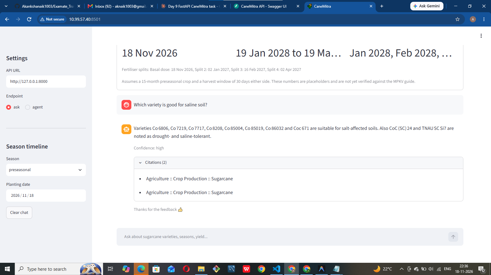

# CaneMitra

CaneMitra (Mitra = friend) is a sugarcane question-answering project for farmers, students and advisors. It collects sugarcane variety records from agricultural university guides, cleans them into one format, and serves them through a command line, a web API (keyword, TF-IDF search and LLM answers) and a Streamlit chat with a season timeline.

**Status:** Week 1 (Days 1-4) is complete (tag `week-1`). Days 5-10 are done. Checkpoint 2 is at Day 10 (tag `checkpoint-2`).



## Day-wise progress

Each day has its own folder with a README that explains the task and lists the exact path of every file. Code used by several days lives in the shared `app/`, `analysis/`, `data/` and `ui/` folders.

| Day    | Folder                                                                                       | What was built                                                                                       |
| ------ | -------------------------------------------------------------------------------------------- | ---------------------------------------------------------------------------------------------------- |
| Day 1  | [`day01/`](https://github.com/Akankshanaik1003/Examate_Training/blob/main/day01/README.md)   | Project card, intro script and interactive menu                                                      |
| Day 2  | [`day02/`](https://github.com/Akankshanaik1003/Examate_Training/blob/main/day02/README.md)   | 16 hand-entered MPKV records, search/count script, reusable data functions and CLI                   |
| Day 3  | [`day03/`](https://github.com/Akankshanaik1003/Examate_Training/blob/main/day03/README.md)   | `Record` dataclass, downloader with error handling, ingest of the TNAU page into `data/records.json` |
| Day 4  | [`day04/`](https://github.com/Akankshanaik1003/Examate_Training/blob/main/day04/README.md)   | FastAPI service, pandas analysis, TF-IDF smart search                                                |
| Day 5  | [`day05/`](https://github.com/Akankshanaik1003/Examate_Training/blob/main/day05/README.md)   | See `day05/README.md`                                                                                |
| Day 6  | [`day06/`](https://github.com/Akankshanaik1003/Examate_Training/blob/main/day06/README.md)   | LLM provider wrapper, `POST /chat`, prompts, prompt comparison                                       |
| Day 7  | [`day07/`](https://github.com/Akankshanaik1003/Examate_Training/blob/main/day07/README.md)   | TODO: one line from your `day07/README.md`                                                           |
| Day 8  | [`day08/`](https://github.com/Akankshanaik1003/Examate_Training/blob/main/day08/README.md)   | TODO: one line from your `day08/README.md`                                                           |
| Day 9  | [`day09/`](https://github.com/Akankshanaik1003/Examate_Training/blob/main/day09/README.md)   | TODO: one line from your `day09/README.md`                                                           |
| Day 10 | [`day10/`](https://github.com/Akankshanaik1003/Examate_Training/blob/main/day10/README.md)   | Streamlit chat UI: calls `/ask` or `/agent`, citations, thumbs up/down, season timeline bar          |

### Day 1 - Project idea and interactive menu

- Defined the project card: product, user, problem and data source.
- `day01/day01_intro.py` prints the card with f-strings and asks the user's name and question.
- `day01/day01_menu.py` is a while-loop menu with sample questions and a planting-month season check.

### Day 2 - Records, data access and CLI

- Hand-entered **16 varieties** from the MPKV sugarcane PDF into `data/sample_records.json`, each checked against the source.
- `day02/day02_s1.py` prints, searches and counts the records.
- `app/records.py` (load, search, count, get by id) and `app/cli.py` (menu CLI).
- Added a virtual environment, `requirements.txt` and `.gitignore`.

### Day 3 - Fetching and ingesting real data

- `app/models.py`: `Record` dataclass.
- `app/fetch.py`: downloads 3 documents into `data/raw/` with `requests`, a 20 second timeout and error handling.
- `app/ingest.py`: cleans the TNAU page into **42 records** in `data/records.json`, skipping bad rows with `try/except`.

### Day 4 - API, analysis and smart search

- `app/main.py`: FastAPI service with `/health`, `/records`, `/records/{id}`, `/search` and `/questions`.
- `app/smart_search.py`: TF-IDF + cosine similarity ranking that powers `/search`.
- `analysis/explore.py`: 3 facts about the records with pandas.
- `app/records.py` gained `load_all_records()`, which combines both data files (58 records).

### Day 5

- TODO: summarise `day05/README.md` in 2-3 bullets.

### Day 6 - LLM wrapper, `/chat` and prompts

- `app/llm.py`: one `generate()` function for Gemini or Groq, with timeout and error handling. Keys come from `.env` (not committed); `.env.example` is committed.
- `app/chat.py` and `POST /chat`: finds the best records, asks the LLM to answer only from them, returns JSON with `answer`, `confidence`, `follow_up` and `sources`.
- `prompts/`: system prompt (v1 and v2) and 2 task prompts.
- `eval/prompt_compare.md`: v1 vs v2 on the 10 user questions.

### Days 7-9

- TODO: 2-3 bullets per day from your `day07/`, `day08/` and `day09/` READMEs. Name the new endpoints (`/ask`, `/agent`) and the files behind them.

### Day 10 - Streamlit UI and season timeline (Checkpoint 2)

- `ui/app.py`: Streamlit chat that calls `/ask` or `/agent` (chosen in the sidebar), shows the answer, confidence and **citations**, and has 👍 / 👎 buttons.
- `ui/feedback.py`: saves every thumbs click as one JSON line in `data/feedback.jsonl`.
- `ui/timeline.py`: the **season timeline bar**. Pick adsali, preseasonal or suru and a planting date; it draws planting, fertiliser split dates and the harvest window month by month.
- Friendly errors when the API is down or slow.
- Screenshot: `docs/day10_ui.png`. Tag: `checkpoint-2`.

## Project structure

```
.
├── README.md
├── .gitignore
├── .env.example             # key names only; copy to .env
├── requirements.txt
├── day01/ ... day10/        # one README per day (day01 and day02 also hold scripts)
├── app/                     # shared package (Days 2-9)
│   ├── __init__.py
│   ├── records.py           # load_records, load_all_records, search, count_by, get_by_id
│   ├── cli.py               # command-line menu
│   ├── models.py            # Record dataclass
│   ├── fetch.py             # download sources into data/raw/
│   ├── ingest.py            # clean raw data into data/records.json
│   ├── smart_search.py      # TF-IDF + cosine similarity search
│   ├── llm.py               # Gemini / Groq wrapper (Day 6)
│   ├── chat.py              # prompt building and JSON reply parsing (Day 6)
│   └── main.py              # FastAPI service (+ /ask and /agent from Days 7-9)
├── ui/                      # Streamlit front end (Day 10)
│   ├── __init__.py
│   ├── app.py               # chat, citations, thumbs, timeline chart
│   ├── timeline.py          # planting, fertiliser splits, harvest window
│   └── feedback.py          # saves thumbs to data/feedback.jsonl
├── prompts/                 # system prompt v1/v2 and 2 task prompts (Day 6)
├── eval/                    # prompt_compare.py and prompt_compare.md (Day 6)
├── analysis/
│   ├── __init__.py
│   └── explore.py           # 3 facts with pandas
├── docs/
│   └── day10_ui.png         # screenshot of the UI
└── data/
    ├── sample_records.json  # 16 hand-entered MPKV records
    ├── records.json         # 42 cleaned TNAU records (output of ingest)
    ├── feedback.jsonl       # thumbs up/down log (created by the UI, not committed)
    ├── raw/                 # downloaded source files
    └── source/
        └── mpkv_sugarcane_varieties.pdf
```

## Setup (Windows)

```
python -m venv .venv
.venv\Scripts\activate
pip install -r requirements.txt
```

`requirements.txt` includes `streamlit` (Day 10). Run every command from the repository root.

## How to run

**Day 1**

```
python day01\day01_intro.py
python day01\day01_menu.py
```

**Day 2**

```
python day02\day02_s1.py
python -m app.cli
```

CLI menu: `1` list all, `2` search by keyword, `3` count per season, `4` count per institute, `5` get by id (for example `V10`), `0` exit.

**Day 3** - download the sources, then clean them:

```
python -m app.fetch
python -m app.ingest
```

**Day 4** - start the API:

```
uvicorn app.main:app --reload
```

Open [http://127.0.0.1:8000/docs](http://127.0.0.1:8000/docs) to try every endpoint in the browser.

| Endpoint                    | What it does                                                                                                            |
| --------------------------- | ----------------------------------------------------------------------------------------------------------------------- |
| `GET /health`               | Status and number of records (58)                                                                                       |
| `GET /records?limit=5`      | First 5 records (default 10)                                                                                            |
| `GET /records/V10`          | One record, or 404 if the id does not exist                                                                             |
| `GET /search?q=saline soil` | Best matching records with a similarity score                                                                           |
| `POST /questions`           | Body `{"question": "..."}`; returns the closest variety, its traits and source                                          |
| `POST /chat`                | Day 6: LLM answer from the best records as JSON (`answer`, `confidence`, `follow_up`, `sources`). Needs a key in `.env` |
| `POST /ask`                 | TODO (Days 7-9): one line on what it returns                                                                            |
| `POST /agent`               | TODO (Days 7-9): one line on what it returns                                                                            |

Example:

```
curl -X POST http://127.0.0.1:8000/questions -H "Content-Type: application/json" -d "{\"question\": \"saline soil\"}"
```

Run the analysis:

```
python -m analysis.explore
```

It prints the top 3 cane yields, the average Maharashtra yield per season, and how many varieties mention drought tolerance.

**Day 10** - the chat UI. Start the API in one terminal, the UI in a second:

```
uvicorn app.main:app --reload
streamlit run ui/app.py
```

Open [http://localhost:8501](http://localhost:8501). In the sidebar choose `ask` or `agent`, a season and a planting date. Check the timeline logic alone with:

```
python -m ui.timeline
```

## Data

| File                       | Records          | Source                                | Seasons                                  |
| -------------------------- | ---------------- | ------------------------------------- | ---------------------------------------- |
| `data/sample_records.json` | 16 (`V01`-`V16`) | MPKV PDF, hand-entered                | adsali, preseasonal, suru                |
| `data/records.json`        | 42 (`T01`-`T42`) | TNAU page, cleaned by `app/ingest.py` | early, mid, late, special (where listed) |

Fields of `sample_records.json`: `id`, `variety_name`, `release_year`, `institute`, `recommended_seasons`, `cane_yield_t_ha` (per season), `duration_months` (per season), `key_traits`, `state`, `source_url`.

Fields of `records.json`: `id`, `variety_name`, `release_year` (always `null`), `recommended_seasons`, `cane_yield_t_ha` (`{"all_seasons": value}`), `key_traits` (duration, CCS %, and a short note where the page has one), `source_url`.

Data notes:

- **V13 (Phule 09057):** the PDF gives no cane yield, so `cane_yield_t_ha` is empty.
- **V16 (Phule 13007):** one yield for all seasons, stored under `all_seasons`.
- **V14 and V15:** the PDF lists a duration of 12 months, stored as `[12, 12]`.
- **TNAU records:** the page gives no release year, so it is `null`; no value was invented. TNAU seasons are Tamil Nadu seasons and are not converted to Maharashtra's. Only some varieties appear in the page's season table, so many records have no season.
- The TNAU records are for Tamil Nadu and are not Maharashtra recommendations. Every record keeps its `source_url`.
- **Feedback:** `data/feedback.jsonl` holds one JSON object per thumbs click (`time`, `rating`, `endpoint`, `question`, `answer`, `sources`).

## Sources

| Source                                                                                                                                                                               | Used for                            | Saved as                                                                  |
| ------------------------------------------------------------------------------------------------------------------------------------------------------------------------------------ | ----------------------------------- | ------------------------------------------------------------------------- |
| MPKV sugarcane varieties PDF: [https://mpkv.ac.in/Uploads/Research/09%20-%20Sugarcane_20230830095518.pdf](https://mpkv.ac.in/Uploads/Research/09%20-%20Sugarcane_20230830095518.pdf) | 16 hand-entered Maharashtra records | `data/raw/mpkv_sugarcane.pdf`, `data/source/mpkv_sugarcane_varieties.pdf` |
| TNAU Agritech sugarcane page: [https://agritech.tnau.ac.in/agriculture/sugarcrops_sugarcane.html](https://agritech.tnau.ac.in/agriculture/sugarcrops_sugarcane.html)                 | 42 cleaned records                  | `data/raw/tnau_sugarcane.html`                                            |
| Third source: WRITE THE NAME AND URL YOU USED IN `app/fetch.py`                                                                                                                      | Extra reference document            | `data/raw/`                                                               |

## Limitations

- Search uses TF-IDF, which matches words and not meaning. Short keyword queries such as `saline soil` work best.
- `POST /questions` returns the best matching records. It does not generate a written answer.
- Season rules and recommendations have not yet been verified against the full source guides and should not be presented as farmer guidance.
- **Season timeline (Day 10):** the crop durations (adsali 18, preseasonal 15, suru 12 months), the fertiliser split days (0/45/90, plus 135 for adsali and preseasonal) and the 30-day harvest window are placeholder assumptions in `ui/timeline.py`. They are not yet verified against the MPKV guide.
- Thumbs feedback is only logged to a local file. Nothing uses it yet to improve answers.

## Git workflow

Each file is committed on its own with a message starting with the day, for example `D3:` or `D10:`. Check `git status` before committing and make sure `.venv` never shows up as staged. The `week-1` tag marks the end of Days 1-4. The `checkpoint-2` tag marks Day 10 (`git tag checkpoint-2` then `git push origin checkpoint-2`).

## Next steps

- Verify the timeline numbers and season rules against the MPKV guide, then read `duration_months` from the matching variety record.
- Use the saved thumbs feedback to find weak answers and improve prompts.
- Add tests for the record-loading, search and timeline functions.
