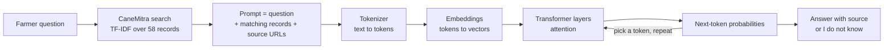

# How LLMs Work (and why it matters for CaneMitra)

This note explains, in simple words, how a Large Language Model (LLM) such as the ones behind ChatGPT or Claude produces an answer. At the end I connect it to CaneMitra.

## 1. What is an LLM?

An LLM is a program that has read a huge amount of text (books, websites, code, articles) and learned the patterns of language. Its one basic job is: **given the text so far, predict the next small piece of text.**

If I write "Sugarcane is a long-duration ...", the model guesses that "crop" is a very likely next word. It adds that word, then predicts the next one, and again, and again. A full answer is just thousands of next-word guesses chained together.

Important: it is not looking up a fact in a database. It is producing the most likely continuation based on patterns it learned. That one idea explains both why LLMs are so useful and why they sometimes make mistakes.

## 2. Tokens: how text is cut into pieces

The model does not read letters or whole words. A **tokenizer** first splits the text into **tokens**, which are small chunks. A token can be a whole common word ("the"), part of a longer word, a number, or punctuation. A word like "sugarcane" may be split into two or three pieces, and rare words, such as variety names like "CoM 0265", are split into more pieces.

Why this matters:
- Models count length in tokens, not words.
- Each token is converted into an ID number before the model sees it.
- Unusual words, names and other languages (for example Marathi) usually take more tokens, so they use more of the model's limit.

Example: `"Phule 265 yield"` becomes something like `["Ph", "ule", " 265", " yield"]` and then a list of ID numbers.

## 3. Embeddings: turning tokens into meaning

A token ID by itself is just a number. The model converts each token into an **embedding**, which is a long list of numbers (a vector) that captures meaning. Tokens with similar meaning get similar vectors. For example, "drought" and "dry" end up closer to each other than "drought" and "smut."

You can think of it like a map: every token has a position, and tokens used in similar ways sit near each other. This is the same idea CaneMitra's search uses in a simpler form. TF-IDF turns each record and the question into vectors and compares them with cosine similarity. TF-IDF only counts words, while LLM embeddings capture meaning, which is why they can match "salty soil" with "salinity tolerant."

## 4. The Transformer and attention

Modern LLMs are built on the **Transformer** architecture. Its key idea is **attention**: when predicting the next token, the model decides which earlier tokens matter most.

Take: "Phule 265 can grow in saline soil. It also gives high yield in preseasonal. **It** is good for ratooning." To understand "It", the model must pay attention to "Phule 265" and not to "soil". Attention lets every token look at every other token in the context and give weights to the ones that matter.

The model has many stacked layers, each with many attention "heads." Early layers pick up simple patterns such as grammar. Later layers pick up deeper relationships such as meaning and context. At the end, the model produces a probability for every possible next token, picks one, and repeats.

## 5. Training vs inference

There are two very different stages:

- **Training** happens once and is extremely expensive. The model reads a massive amount of text, tries to predict the next token, checks how wrong it was, and adjusts billions of internal numbers (**parameters or weights**) a little bit. This is repeated for a very long time. After basic training, the model is usually tuned again with human feedback so that it follows instructions and answers helpfully and safely.
- **Inference** is what happens when you ask a question. The weights are fixed and nothing new is learned. The model just uses what it learned to predict tokens for your prompt.

Consequence: the model's knowledge stops at its training cut-off date. It does not automatically know today's sugarcane price, this year's factory schedule, or anything inside my private files.

## 6. Context window: the model's working memory

The **context window** is the maximum amount of text, in tokens, that the model can look at at one time. It includes my question, any documents I give it, the conversation so far, and the answer it is writing. If the text is longer than the window, the oldest part gets cut or ignored.

Everything the model "knows" about my specific task has to fit inside this window. It cannot read my entire folder of PDFs. This is why we cannot just paste all of CaneMitra's data into every question and why we first **search** for the few records that matter.

## 7. Hallucination: confident but wrong

Because an LLM predicts likely text, it can produce an answer that sounds correct but is false. This is called **hallucination**. It happens more when:
- the information is rare or very specific (an exact yield figure for one variety),
- the information is newer than the training data,
- the question asks for something the model does not actually have, and it fills the gap with a believable guess.

For a farmer this is risky. A made-up fertilizer dose, planting month or variety trait could cost a season's income. So CaneMitra must not rely on what the model "remembers."

## 8. Why this matters for CaneMitra

CaneMitra's job is to answer sugarcane questions for Maharashtra farmers using trusted sources (MPKV, TNAU). Using what I learned above:

- A plain LLM does not hold CaneMitra's 58 records. If asked "How many months does Phule 265 take in suru season?" it might guess. The correct figure is in our data: 12 to 14 months.
- So the safe design is: **search first, then answer from the records.** This pattern is called **retrieval-augmented generation (RAG)**: retrieve the matching records, put them inside the context window along with the question, and tell the model to answer only from them and to say "I don't know" when the records do not contain the answer.
- Our API already does the retrieval half. `POST /questions` uses TF-IDF and cosine similarity to find the closest records and returns the best one with its `source_url`, so the farmer can check it. A future step could pass these records to an LLM to write a clear answer in simple Marathi or English.
- **Known limit today:** `/questions` returns the "closest" record even when the data cannot really answer (for example a fertilizer-dose question), because TF-IDF only matches words. A better version should check the match score and answer "not in our data."
- Our data also has gaps the model cannot fill: no weather, no market price, no fertilizer or pest-control advice, and TNAU records are for Tamil Nadu, not Maharashtra.

## Diagram: where CaneMitra's data enters the LLM

**Reading the diagram:** the first two boxes are CaneMitra's own data being added before the model sees anything. Without them, the model would answer only from its training memory and could hallucinate. The loop between the Transformer layers and the probabilities is the model producing the answer one token at a time.

## Quick glossary

| Term | One-line meaning |
|------|------------------|
| Token | A small chunk of text the model reads |
| Embedding | A list of numbers that represents the meaning of a token |
| Attention | How the model decides which earlier words matter |
| Parameters / weights | The numbers learned during training |
| Training | Learning from huge text (one time, expensive) |
| Inference | Using the trained model to answer a question |
| Context window | How much text the model can see at once |
| Hallucination | A confident answer that is wrong |
| RAG | Retrieve relevant data first, then let the model answer from it |